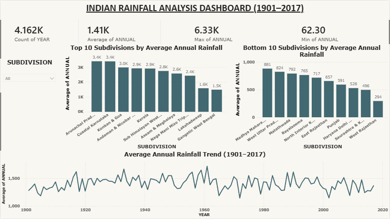

# SWYNEX – Interactive Indian Rainfall Dashboard

## Project Overview
This project presents an interactive Power BI dashboard analyzing historical Indian rainfall data from 1901 to 2017.

## Tools Used
- Microsoft Power BI
- Data visualization and interactive reporting

## Dashboard Features
- Average annual rainfall
- Highest annual rainfall
- Lowest 10 rainfall subdivisions
- Top 10 rainfall subdivisions
- Annual rainfall trend
- Interactive subdivision slicer

## Dashboard Preview

## Project File
- `SWYNEX_Indian_Rainfall_Dashboard.pbix` – Power BI dashboard file.

## Objective
The objective of this project is to explore historical rainfall patterns and compare average annual rainfall across Indian subdivisions using interactive visualizations.

## Conclusion
This project provided practical experience in building interactive dashboards, comparing rainfall data, and presenting insights through Power BI.
